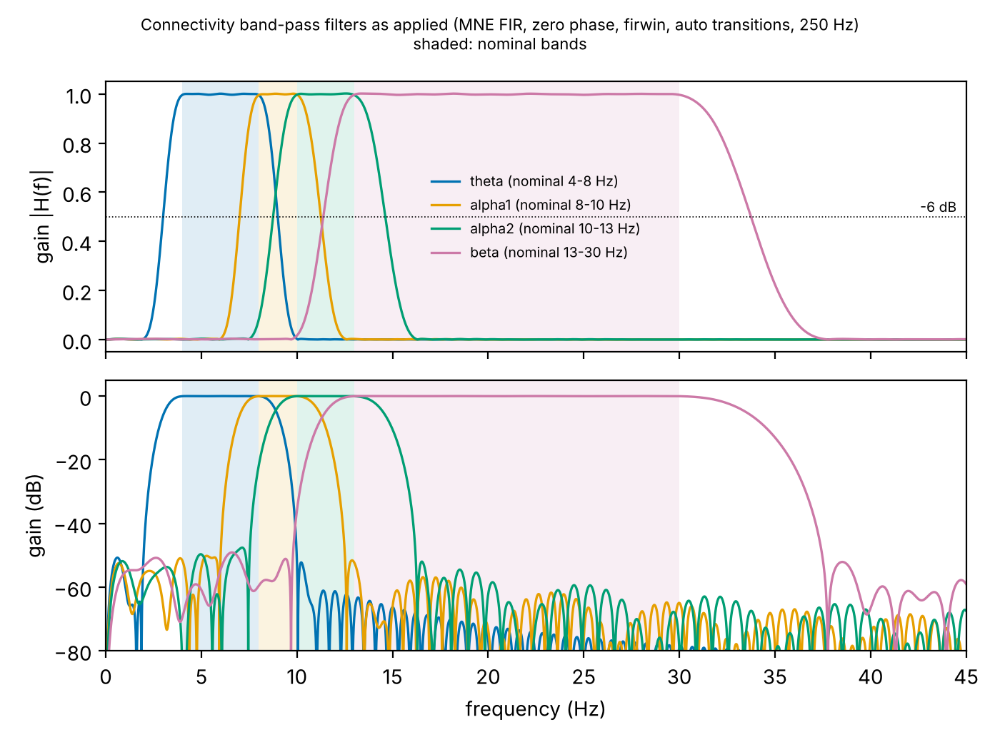

# Connectivity band-pass filters: actual responses (alpha1 / alpha2 verification)

Status: **documentation only. No band definition or filter parameter has been changed.**
Any change needs the author's approval (methodology log entry 35, open item 8).

Regenerate the numbers and the figure with `python scripts/inspect_band_filters.py`. This
writes `results/tables/band_filter_responses.csv` and `docs/img/band_filter_responses.png`.
No EEG is involved.

## What is applied

`adgraph.connectivity.plv.band_analytic` filters the continuous ROI signals per band with MNE
`filter_data`, then takes the Hilbert transform. The filter is:

- FIR, zero phase, `firwin` design, Hamming window;
- MNE's automatic (`'auto'`) transition bandwidths and filter length;
- 250 Hz sampling rate (`configs/pipeline.yaml`).

The script checks that the kernel it analyses is the one `filter_data` applies, by passing a
unit impulse through it. With `phase='zero'` the kernel is applied once, so the gain is |H(f)|.

MNE's `'auto'` rule:

- lower transition width = min(max(0.25 · l_freq, 2 Hz), l_freq);
- upper transition width = min(max(0.25 · h_freq, 2 Hz), Nyquist − h_freq).

The −6 dB point lies at the middle of each transition band.

## Measured responses

**Nominal band, transition bands and filter length**

| Band | Nominal band (config) | Lower transition | Upper transition | Filter length |
|---|---|---|---|---|
| theta | 4–8 Hz | 2–4 Hz (2.0 Hz wide) | 8–10 Hz (2.0) | 413 samples (1.65 s) |
| alpha1 | 8–10 Hz | 6–8 Hz (2.0) | 10–12.5 Hz (2.5) | 413 samples (1.65 s) |
| alpha2 | 10–13 Hz | 7.5–10 Hz (2.5) | 13–16.25 Hz (3.25) | 331 samples (1.32 s) |
| beta | 13–30 Hz | 9.75–13 Hz (3.25) | 30–37.5 Hz (7.5) | 255 samples (1.02 s) |

**Measured edges**

| Band | Passband (gain ≥ −0.1 dB) | −3 dB band | −6 dB band | −40 dB stopband edges |
|---|---|---|---|---|
| theta | 3.91–8.10 Hz | 3.25–8.76 | 3.00–9.00 | 2.08–9.90 |
| alpha1 | 7.91–10.13 Hz | 7.25–10.95 | 7.00–11.25 | 6.09–12.39 |
| alpha2 | 9.86–13.14 Hz | 9.06–14.23 | 8.76–14.62 | 7.62–16.08 |
| beta | 12.83–30.37 Hz | 11.78–32.83 | 11.38–33.74 | 9.93–37.13 |

**Output power for a flat (white) input spectrum**

| Band | Outside its nominal band | In theta | In alpha1 | In alpha2 | In beta |
|---|---|---|---|---|---|
| theta | 27.6 % | — | 13.8 % | <0.01 % | <0.01 % |
| alpha1 | 46.2 % | 20.4 % | — | 25.7 % | <0.01 % |
| alpha2 | 42.2 % | 0.01 % | 18.3 % | — | 5.9 % |
| beta | 19.4 % | <0.01 % | <0.01 % | 23.9 % | — |

**−6 dB overlaps between neighbouring bands**

| Bands | Overlap |
|---|---|
| theta / alpha1 | 7.00–9.00 Hz |
| alpha1 / alpha2 | 8.76–11.25 Hz |
| alpha2 / beta | 11.38–14.62 Hz |

## Findings

1. **The passbands are as defined.** Gain is within 0.1 dB of 1 from (nominal low − about
   0.1 Hz) to (nominal high + about 0.15 Hz) for every band. The nominal band definitions are
   implemented correctly.
2. **The overlap comes from the transition bands, not the passbands.**
   - MNE's automatic transitions are 2–3.25 Hz wide at the alpha edges. That is as wide as the
     2 Hz alpha1 band and almost as wide as the 3 Hz alpha2 band.
   - The effective (−6 dB) bands are alpha1 ≈ 7.0–11.25 Hz and alpha2 ≈ 8.8–14.6 Hz. They
     share about 2.5 Hz (8.76–11.25 Hz).
   - For a flat spectrum, 46 % of alpha1's output power lies outside 8–10 Hz (26 % in the
     alpha2 band, 20 % in theta). For alpha2 the figure is 42 % (18 % in alpha1, 24 % in beta).
3. **The overlap is larger for real EEG than for a flat spectrum.**
   - Resting EEG has a dominant alpha peak, typically 8–10 Hz and often lower in AD (alpha
     slowing).
   - The alpha2 filter passes 67 % of the amplitude at 9 Hz, 92 % at 9.5 Hz and 100 % at
     10 Hz (its lower transition is 7.5–10 Hz). Alpha2 phase estimates can therefore be driven
     substantially by the same peak oscillation that drives alpha1, so alpha1/alpha2 PLV and
     |ciPLV| are expected to be strongly correlated.
   - Theta similarly passes 87 % at 8.5 Hz and 50 % at 9 Hz.
4. **PSD features are unaffected.** They use exact half-open frequency bins (Welch), so PSD
   bands do not overlap. Connectivity and PSD band features are therefore not equally
   band-limited.
5. **No numerical defect.** These are standard MNE defaults, applied as documented. They are
   a methodological choice: a short filter (good time resolution within 20 s windows) traded
   against frequency selectivity.

## Options for the author (not applied)

- **(a) Keep as is.** Report the effective −6 dB bands next to the nominal bands, and treat
  alpha1 and alpha2 connectivity as overlapping (not independent) in interpretation and in
  band-specific claims (Exp 2/3, Fig. 4).
- **(b) Narrower transitions.** Set explicit `l_trans_bandwidth` / `h_trans_bandwidth`, e.g.
  1 Hz, via a new config field.
  - Filters become about 3.3 s long (825 samples), still well inside the 20 s windows.
    Filtering is done on the continuous signal, so window edges are unaffected.
  - The −6 dB alpha1/alpha2 overlap shrinks to about 9.5–10.5 Hz.
  - This is a method change: log it in `docs/methods_decisions.md` and rebuild the graphs.
- **(c) Change the band definitions.** For example, merge alpha1 and alpha2, or use
  individual alpha peak frequency bands. This is a larger scientific change.
