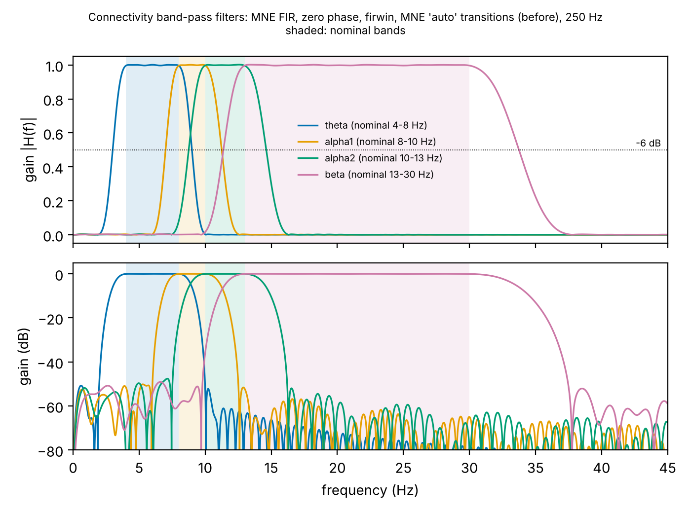
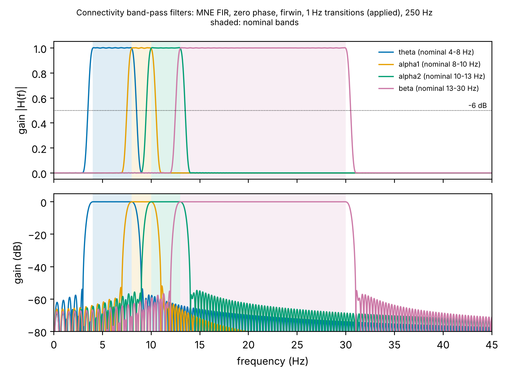

# Connectivity band-pass filters: design, before/after comparison

**Nominal bands unchanged:** theta 4–8, alpha1 8–10, alpha2 10–13, beta 13–30 Hz.

**Changed** (methodology log entry 36, methods decisions #45, author instruction 2026-10-13):
the filter transition widths. These went from MNE's automatic widths to **1.0 Hz on every band
edge** (`connectivity.transition_bandwidth_hz: 1.0` in `configs/pipeline.yaml`).

**Unchanged** everything else:
- MNE FIR, zero phase, `firwin` / Hamming design, automatic filter length;
- filtering of the continuous ROI signals before windowing;
- the Hilbert phase, PLV and ciPLV definitions;
- the 20 s / 50 % windows.

Regenerate:

```bash
python scripts/inspect_band_filters.py --design auto     # before
python scripts/inspect_band_filters.py --design config   # after (as applied)
python scripts/compare_band_filter_designs.py            # synthetic comparison of candidate widths
```

These write `results/tables/band_filter_responses_{auto,config}.csv`,
`results/tables/band_filter_design_comparison.csv` and
`docs/img/band_filter_responses_{auto,config}.png`. The inspection script checks, by passing a
unit impulse through the filter, that each analysed kernel is the one `filter_data` applies.
No EEG is involved.

| Before: MNE 'auto' transitions | After: 1.0 Hz transitions (applied) |
|---|---|
|  |  |

## Frequency response

| Band | Design | Transitions (low / high) | Passband (≥ −0.1 dB) | −6 dB band | Power outside nominal band (flat input) | −6 dB overlap with next band |
|---|---|---|---|---|---|---|
| theta | before | 2.0 / 2.0 Hz | 3.91–8.10 | 3.00–9.00 | 27.6 % | 7.00–9.00 |
| | **after** | 1.0 / 1.0 Hz | 4.0–8.0 | **3.50–8.50** | **16.0 %** | **7.50–8.50** |
| alpha1 | before | 2.0 / 2.5 Hz | 7.91–10.13 | 7.00–11.25 | 46.2 % | 8.76–11.25 |
| | **after** | 1.0 / 1.0 Hz | 8.0–10.0 | **7.50–10.50** | **27.6 %** | **9.50–10.50** |
| alpha2 | before | 2.5 / 3.25 Hz | 9.86–13.14 | 8.76–14.62 | 42.2 % | 11.38–14.62 |
| | **after** | 1.0 / 1.0 Hz | 10.0–13.0 | **9.50–13.50** | **20.3 %** | **12.50–13.50** |
| beta | before | 3.25 / 7.5 Hz | 12.83–30.37 | 11.38–33.74 | 19.4 % | – |
| | **after** | 1.0 / 1.0 Hz | 13.0–30.0 | **12.50–30.50** | **4.3 %** | – |

- The −6 dB points now sit exactly half a transition width outside each nominal edge.
- Neighbouring bands overlap only within ±0.5 Hz of their shared edge. For alpha1/alpha2 that
  is 9.5–10.5 Hz, down from 8.76–11.25 Hz.
- Stopband attenuation is unchanged at about −53 dB (Hamming).
- "Power outside nominal" is for a flat spectrum. Even an ideal brick-wall filter has 0 %; the
  remainder lies within the ±1 Hz transitions.

## Temporal effects

| Design | Filter length | Half-length (start-up at recording ends) | 90 %-energy span of impulse response (alpha1) |
|---|---|---|---|
| before | 1.0–1.65 s (255–413 samples) | ≤ 0.83 s | 0.21 s |
| **after** | **3.3 s (825 samples)** | **1.65 s** | **0.32 s** |

- **Start-up stays out of the windows.** The bands are filtered on the continuous signal, so
  start-up affects only the first and last half-length of each recording. The 10 s edge trim
  removes these before windowing. `check_filters_fit_edge_trim` enforces half-length < edge
  trim at every run.
- **Smearing is small.** A phase value now depends mostly on about ±0.16 s of signal, small
  relative to the 20 s windows. As before, windows overlapping by 50 % share signal and are
  never split across folds.
- **Phase is undistorted.** Zero-phase design: no delay or phase distortion, before or after.

## PLV and |ciPLV| consistency on synthetic signals

Setup:
- 5 min of two-channel 1/f noise, 250 Hz, analysed in 20 s windows with 50 % overlap after a
  10 s edge trim, as in the pipeline;
- coupled scenarios add an oscillation with a fixed π/3 lag, so |ciPLV| sees it too;
- each value is the mean over windows (`results/tables/band_filter_design_comparison.csv`).

| Scenario | Band | before PLV / ciPLV | 1.5 Hz | **1.0 Hz (applied)** | 0.5 Hz |
|---|---|---|---|---|---|
| coupling at 9 Hz (alpha1 only) | alpha1 | 0.86 / 0.83 | 0.88 / 0.85 | **0.90 / 0.87** | 0.92 / 0.89 |
| | alpha2 (should be null) | **0.67 / 0.62** | 0.20 / 0.18 | **0.11 / 0.06** | 0.11 / 0.07 |
| | theta (should be null) | 0.28 / 0.24 | 0.09 / 0.06 | 0.08 / 0.05 | 0.08 / 0.05 |
| coupling at 11.5 Hz (alpha2 only) | alpha2 | 0.86 / 0.83 | 0.89 / 0.86 | **0.90 / 0.88** | 0.91 / 0.89 |
| | alpha1 (should be null) | **0.34 / 0.31** | 0.08 / 0.05 | **0.08 / 0.06** | 0.09 / 0.06 |
| | beta (should be null) | 0.38 / 0.34 | 0.05 / 0.03 | 0.05 / 0.04 | 0.05 / 0.03 |
| independent noise (floor) | alpha1 | 0.084 / 0.047 | 0.102 / 0.062 | **0.110 / 0.068** | 0.115 / 0.069 |
| | alpha2 | 0.087 / 0.043 | 0.099 / 0.055 | **0.104 / 0.058** | 0.099 / 0.059 |

## Why 1.0 Hz

- **The old design was not band-specific.** An oscillation entirely inside alpha1 (9 Hz)
  produced alpha2 PLV 0.67 (|ciPLV| 0.62), close to its true-band value. An alpha2
  oscillation (11.5 Hz) appeared in alpha1 (0.34) and beta (0.38). Band-specific claims (Exp 2/3,
  Fig. 4, fusion weights) would have been confounded, especially for alpha peaks near 9–10 Hz,
  common in AD (alpha slowing).
- **1.0 Hz removes the contamination.** Off-band PLV falls to the noise floor (0.11 vs a floor
  of 0.10–0.11), and in-band coupling is recovered slightly better.
- **1.5 Hz is not enough.** It leaves residual leakage (alpha2 PLV 0.20 for 9 Hz coupling).
- **0.5 Hz buys nothing measurable.** It doubles filter length (6.6 s) and temporal smearing,
  raises the noise floor slightly, and gives no measurable gain in specificity.
- **The cost is a slightly higher noise floor** (alpha1 0.084 → 0.110). This follows from the
  narrower effective bandwidth (fewer independent cycles per window) and affects all subjects
  and both classes equally.
- **One width for all bands** keeps the design uniform. Theta and beta also become cleaner
  (beta out-of-band power 19 % → 4 %).

## Remaining caveats

- Activity within ±0.5 Hz of a shared edge (e.g. 9.5–10.5 Hz) still contributes to both
  neighbouring bands. This is unavoidable with finite-length filters, and much narrower than
  before.
- Results computed with the previous design are not comparable. No real-data graphs were built
  with it, and the config hash change gives a new graph-run directory.
